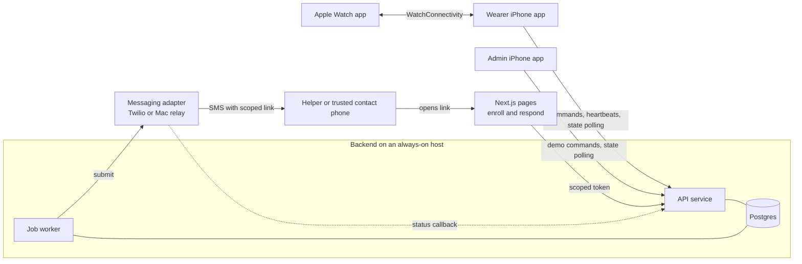

# Project KAZE — Implementation Plan

October 16, 2026 · Based on [PROJECT_KAZE_PRD.md](PROJECT_KAZE_PRD.md) · "PRD §n" points to a section of the PRD

This plan turns the PRD into a build order. It covers what to decide first, the shared contracts (data model, states, API), how the backend keeps time, what each workstream builds, and how each acceptance check (PRD §9) gets demonstrated. Times assume about 36 hacking hours; scale them if the event is shorter.

## 1. Decisions

### 1.1 Recommended stack

The PRD leaves vendors open (PRD §5). These defaults keep moving parts to a minimum. Swap any of them for something the team knows better.

| Area | Recommendation | Why |
| --- | --- | --- |
| API | Node.js 22 + TypeScript + Fastify, with zod schemas | One language for API and web; the schemas double as the contract. |
| Database | Postgres (hosted Supabase project) | Transactions and row locks make response-versus-timeout races simple to settle. |
| Timers | A `scheduled_jobs` table polled by a separate worker process | Jobs are written in the same transaction as the state change, survive restarts, show up in the admin app, and cancel by demo run. |
| Hosting | API and worker on an always-on host (Render, Railway, or Fly.io) | The worker must run continuously, so serverless functions won't hold deadlines. It also avoids depending on venue Wi-Fi and a laptop. |
| Live updates | Clients poll a state endpoint that returns a revision number (every 1 s in the demo) | Fewest moving parts. Add server-sent events later only if polling becomes a problem. |
| SMS | Twilio behind a messaging adapter, with a Canadian number and the demo recipients added as verified numbers | Doesn't tie up the Mac. A Mac Messages relay is the fallback adapter. |
| Web pages | Next.js on Vercel, fetching data client-side from the API | Private data never sits in server-rendered or cached HTML. |
| Apple apps | One Xcode workspace: Wearer (iOS), Wearer Watch App (watchOS), Admin (iOS), plus a shared `KazeKit` Swift package | The admin app becomes a thin UI over the same client code. |

### 1.2 Confirm in the first hours (PRD §10)

- [ ] An owner for each of the four workstreams in §7.
- [ ] Demo phone and watch models and OS versions. Native double tap needs Apple Watch Series 9, Ultra 2, or newer on watchOS 11+. Check on the actual watch with its accessibility settings.
- [ ] Apple Developer account type. Free provisioning can install to devices but expires after 7 days and has app limits; push notifications need a paid membership. This plan does not depend on push.
- [ ] SMS route chosen, with one test message received on every designated demo recipient.
- [ ] Demo recipient roles: venue helper, trusted contacts 1 and 2, and one deliberately unreachable contact for the failed-submission check.
- [ ] Defaults for the open questions in §11.

## 2. Architecture



Three rules shape everything else:

- **The backend is the only clock that matters.** Clients display backend deadlines; no client timer can cause or prevent an alert.
- **Wearer input goes watch → iPhone → API.** The watch does not call the API directly in the MVP.
- **Clients never trust their own view after a gap.** After any reconnect they fetch authoritative state before showing anything as confirmed.

## 3. Data model

Every row that belongs to a demo run carries `demo_run_id`. Share settings are a set of flags: `name`, `venue`, `location`, `contact_info`, `help_card`.

| Table | Key fields |
| --- | --- |
| `users` | display name, `is_demo`, safety PIN hash, duress PIN hash, help card, timing settings (grace, response window, ack window, follow-up window, heartbeat grace, retries) |
| `devices` | owner, kind (`wearer_phone` or `admin_phone`), token hash |
| `contacts` | user, name, phone, position in escalation order, share settings |
| `sessions` | user, current `demo_run_id`, monitoring state, venue, expected end, `revision`, last heartbeat, watch reachable, last watch contact, last location with timestamp, last safety confirmation |
| `check_ins` | session, state, `prompt_at`, `respond_by`, responded at, response source |
| `incidents` | session, status, trigger, `concealed_from_wearer`, responder progress, current responder, wearer safety report time, `no_responder_confirmed`, resolution reason, resolved by |
| `routing_steps` | incident, position, recipient (contact or coverage), state |
| `delivery_attempts` | routing step, attempt number, state, provider message id, provider status, error |
| `coverages` | user, venue, helper name and phone, start, end, state, accepted at, share settings |
| `access_tokens` | token hash, purpose (`enroll` or `respond`), scope ids, expiry, revoked at, first opened at |
| `otp_codes` | coverage, code hash, expiry, attempt count |
| `scheduled_jobs` | kind, target id, `demo_run_id`, `run_at`, state, unique `dedupe_key`, attempts, locked at |
| `events` | session, incident, `demo_run_id`, actor type and id, type, payload, server time, revision, `simulated`, `visible_to_wearer` |
| `idempotency_keys` | key, actor, route, stored response, created at |
| `admin_assignments` | admin device, session |

A partial unique index on `incidents (session_id) WHERE status = 'open'` enforces one open incident per session.

## 4. State machines

No single alarm boolean (PRD §6). Each of these moves independently.

| Model | States and transitions |
| --- | --- |
| Monitoring | `inactive → active → ended`. The phone shows `registration pending` and `end pending` while its command is in flight; the backend only stores confirmed states. |
| Check-in | `scheduled → awaiting_response → confirmed` or `expired`. `scheduled` or `awaiting_response → cancelled` on extend, end, PIN cancel, or reset. |
| Incident | `open → resolved`, with resolution `responder_resolved`, `safety_pin_cancel`, or `operator_stop`. Responder progress, wearer safety report, and `no_responder_confirmed` are separate fields. |
| Responder progress | `unassigned → acknowledged → assistance_arranged → resolved` |
| Routing step | `pending → notifying → notified → acknowledged`, `declined`, `timed_out`, or `failed`. Any not-yet-notified step can become `skipped`. |
| Delivery attempt | `queued → submitting → submitted`, `failed`, or `unknown`. Provider evidence (carrier "delivered") is stored next to it, never in place of it. |
| Coverage | `invited → verified → accepted`, then `expired` or `revoked`. Coverage counts as active only when accepted and the current time is inside its period. |

## 5. Backend design

### 5.1 API

All mutating requests carry an `Idempotency-Key` header; a repeat returns the stored first response. All responses carry `server_time`, `revision`, and `demo_run_id`. A request for an old run gets `409 stale_run`. Endpoints return one of three projections (wearer, responder, admin), each built by a single function that applies permissions. They never return raw rows.

| Caller | Endpoint | Purpose |
| --- | --- | --- |
| Wearer | `POST /v1/wearer/setup` | Create user and device token |
| Wearer | `PUT /v1/wearer/config`, `/contacts`, `/pins` | Name, timings, help card; ordered contacts with share settings; safety and duress PINs |
| Wearer | `POST /v1/sessions` | Start. Returns only after the deadlines and jobs are stored. |
| Wearer | `POST /v1/sessions/:id/extend`, `/end` | Replace the expected end; stop future check-ins |
| Wearer | `POST /v1/sessions/:id/heartbeat` | Watch reachable, last watch contact, optional location |
| Wearer | `POST /v1/sessions/:id/confirm` | **I'm okay**, with `check_in_id` (or none for a voluntary tap) and source |
| Wearer | `POST /v1/sessions/:id/help` | **Get help** |
| Wearer | `POST /v1/sessions/:id/cancel` | PIN entry. Identical response for the safety and duress PINs. |
| Wearer | `POST /v1/coverage/invitations`, `/coverage/:id/revoke` | Invite a helper (returns enrollment link for the QR code); revoke |
| Wearer | `GET /v1/sessions/:id/state` | Wearer projection |
| Helper | `GET /v1/enroll/:token`, `POST .../code`, `.../verify`, `.../accept` | Coverage terms, send code to the invited number, check it, explicit acceptance |
| Responder | `GET /v1/respond/:token`, `POST .../action` | Responder projection; acknowledge, decline, arranging, resolved with outcome |
| Admin | `GET /v1/admin/sessions`, `/sessions/:id` | Assigned sessions; admin projection with deadlines, last response, routing, deliveries, jobs, events |
| Admin | `POST /v1/admin/sessions/:id/trigger-checkin`, `/trigger-help` | Labeled simulated events, with a response-window override |
| Admin | `POST /v1/admin/incidents/:id/stop` | Operator stop with a required reason |
| Admin | `POST /v1/admin/sessions/:id/reset` | Start a new demo run |
| Provider | `POST /v1/webhooks/sms-status` | Delivery status callback, signature checked |

### 5.2 Timers and jobs

| Job | Runs at | Does, after its recheck |
| --- | --- | --- |
| `checkin.prompt` | `prompt_at` | Check-in `scheduled → awaiting_response` |
| `checkin.expire` | `respond_by` | Check-in `awaiting_response → expired`; open a missed-check-in incident |
| `step.notify` | now | Create a delivery attempt and submit the SMS |
| `step.ack_timeout` | submitted + ack window | Step `notified → timed_out`; advance |
| `delivery.retry` | now + backoff | Resubmit if retries remain, otherwise mark the step failed and advance |
| `incident.followup` | last progress + follow-up window | If progress hasn't moved, alert the next eligible recipient |
| `coverage.expire` | coverage end | Expire coverage, revoke the helper's tokens, reroute any open incident |
| `heartbeat.sweep` | every 2 s | Open a heartbeat-loss incident for active sessions whose phone heartbeat or watch contact is older than the grace period |

For a planned outing, `prompt_at` = expected end + grace, and `respond_by` = `prompt_at` + response window.

The worker loop:

1. Every 250–500 ms, claim due jobs with `UPDATE … SET state = 'running' WHERE id IN (SELECT id … WHERE state = 'pending' AND run_at <= now() ORDER BY run_at FOR UPDATE SKIP LOCKED LIMIT 20) RETURNING *`.
2. Run each handler in a transaction that locks its target row and checks two things: the job's `demo_run_id` is still the session's current run, and the target is still in the state the job expects. If either check fails, mark the job `skipped`. Otherwise apply the transition, write events, and enqueue follow-on jobs in that same transaction.
3. Return jobs stuck in `running` for more than 30 s to `pending` (worker crash). Re-running is safe because of step 2 and the unique dedupe keys, such as `expire:<check_in_id>` and `notify:<step_id>:<attempt>`.

Accepted responses, extensions, cancellations, and resets mark the jobs they make obsolete as `cancelled` in their own transaction. Step 2 is the backstop.

Sending an SMS is the one step that can't sit inside a transaction:

1. In a transaction, recheck incident state and permissions, create the attempt as `submitting`, and commit.
2. Call the provider.
3. In a second transaction, record `submitted` or `failed`. A timeout becomes `unknown`.

An attempt found stuck in `submitting` after a crash becomes `unknown` and is shown in the admin app. It is not resent automatically, because external delivery can't be exactly-once.

### 5.3 Rules that settle races

- **Response versus timeout.** Under a lock on the check-in row, a response counts as on time if the server received it at or before `respond_by`, whether or not the expire job has run yet. Otherwise it is a late safety response.
- **One logical incident.** A Help tap, duress PIN, or heartbeat loss while an incident is open attaches to that incident as an event; it does not create a second one.
- **Extend.** Inside one transaction, set the new expected end, bump the revision, cancel the old check-in jobs, and schedule new ones. The phone shows the new deadline only after the response arrives.
- **End monitoring.** Cancel future check-ins. An open incident stays open.
- **Voluntary safety tap** (outside a pending check-in). Update the last confirmation time and leave the registered deadline alone.
- **Late "I'm okay".** Record the wearer's safety report, cancel unsent steps and their jobs, and send an update to everyone already contacted. The incident stays open until a safety-PIN cancel or a responder resolution.
- **Safety PIN.** Resolve the open incident with reason `safety_pin_cancel` (or confirm an awaiting check-in), cancel jobs, and notify everyone already contacted.
- **Duress PIN.** Return exactly what a safety-PIN cancel returns. Behind that, create or keep the incident, mark it `concealed_from_wearer`, and route it normally. The wearer projection then treats that incident as resolved and hides its events, including on the watch: no responder acknowledgment, no timeline.
- **Coverage handoff.** On expiry or revocation, revoke the helper's tokens, mark their unsent steps `skipped`, and continue with trusted contacts. This never resolves an incident.
- **Reset.** Create a new `demo_run_id`, cancel the old run's jobs, revoke its tokens, and resolve its open incidents as `operator_stop`. Anything later that carries the old run id is rejected or skipped.

### 5.4 Escalation

1. When an incident opens, build its routing list: the accepted helper first if coverage is active, then trusted contacts in their configured order. Show this order in the wearer and admin apps.
2. `advance` picks the next `pending` step whose recipient is still eligible and enqueues `step.notify`. After submission it schedules `step.ack_timeout`.
3. Decline, timeout, or a failed submission with no retries left marks the step and calls `advance`.
4. Acknowledge records who acted and when, cancels that step's timeout, sets progress to `acknowledged`, and schedules `incident.followup`. Arranging help moves progress forward and resets the follow-up. Resolved closes the incident with the responder's outcome.
5. Any responder already notified, with a valid token, may still act, including after their own timeout.
6. When no eligible steps remain, set `no_responder_confirmed` and keep the incident open. Every view shows "No responder confirmed".

### 5.5 Messaging

- One adapter interface: `submit(to, body, key) → { state, providerMessageId, error }`. Implementations: `console` (local development and tests), `twilio`, and `mac-relay` as the fallback.
- Delivery states come only from our side of the call (PRD §5). Twilio's `delivered` callback is stored as "carrier reported delivered", which is still not proof that a person saw it.
- Observed receipt is the responder page calling the API, or a responder action. Recording "opened" only from client-side JavaScript keeps link-preview fetchers from counting as a person.
- Message bodies hold a short reason and the link, never private details. The link carries only a random token.
- Twilio trial accounts send only to verified numbers, which suits designated demo recipients. Register them in the first hours.

### 5.6 Security and privacy enforcement

- Tokens are 32 random bytes, stored as SHA-256 hashes, scoped to one purpose and object, with expiry and revocation checked on every request. Revocation therefore cuts off a page that is already open on its next poll.
- PINs and one-time codes are hashed and attempt-limited. A wrong PIN never cancels anything.
- Responder projections include only fields the wearer permitted for that recipient, and location only while the incident is open, labeled "last known" with its time. Missing location never blocks an alert; venue and session details stand in for it.
- Enrollment pages show the venue, the coverage period, and what would be shared during an alert. They show no wearer details.
- Admin tokens work only on admin routes, and only for assigned sessions. Every denial is logged as an event.
- Web pages send `Cache-Control: no-store` and `Referrer-Policy: no-referrer`, use a generic page title, and publish no link-preview metadata. Map links use `rel="noreferrer"`.
- Logs contain ids only: no phone numbers, locations, PINs, tokens, or help-card text. Provider credentials stay on the server.
- Demo users are flagged `is_demo`, and an admin-only route clears demo data.

## 6. Client apps

**Wearer iPhone app**

- Setup: chosen name, ordered trusted contacts with per-contact sharing, timings, help card, safety and duress PINs. Sharing choices stay separate from iOS permission prompts.
- Session screen: start, extend, end; the backend deadline, phone and watch connection status, helper coverage with its trusted fallback, and incident status. Don't claim coverage until a trusted fallback exists.
- Every command shows `Sending… → Confirmed` or `Not confirmed`. After reconnecting, refetch state.
- Poll state every 1 s during the demo. Send a heartbeat every 5 s with watch reachability and, if permitted, location.
- Helper invite: enter the helper's name and number and the coverage period, show the QR code (Core Image's QR generator), then show acceptance, expiry, and a revoke button.
- PIN pad: one screen for both PINs, with an identical result screen.

**Apple Watch app**

- Main screen: status, one dominant **I'm okay** button, an accessible **Get help** button. Configuration lives off this screen.
- Check-in prompt: large text, a countdown computed from the backend's `respond_by` (display only), and a strong haptic repeating every couple of seconds until the check-in is answered.
- Double tap: `.handGestureShortcut(.primaryAction)` on **I'm okay** only, never on **Get help**.
- Sends commands to the phone with `WCSession.sendMessage`, with an idempotency key, and stays "pending" until the phone relays the backend's acceptance. If the phone isn't reachable, it shows "Not sent" instead of success.
- Pings the phone every few seconds so the phone can report reachability. Uses `updateApplicationContext` as a backup channel for the latest state.

**Admin iPhone app**

- A permanent **Demo mode** banner, a session picker limited to assigned sessions, and connection status.
- Live view: deadline, last response, routing order with each delivery's state, responder progress, pending jobs, and the event timeline.
- Actions: trigger check-in (with a window override), trigger help, stop the incident (reason required), and reset the run.

**Web pages (Next.js)**

- `/e/[token]`: coverage terms, phone verification by code, and an explicit accept button.
- `/r/[token]`: permitted identity, alert time and reason, last-known location with a map link, the help card, and a short timeline. Large **Acknowledge**, **Decline**, **Arranging help**, and **Resolved** buttons (with an outcome).
- Both pages poll every 2 s. When access ends they clear what's on screen and say that information already received can't be recalled.
- Status colors always come with text: green safe, yellow awaiting response, red alert, blue acknowledged, gray resolved.

## 7. Workstreams and timeline

The Mac is the bottleneck: Xcode and device provisioning share it (PRD §10). Owner A gets it first. If the team has three people, split workstream D between the B and C owners.

| Owner | Phases 0–1 | Phases 2–3 | Phases 4–5 |
| --- | --- | --- | --- |
| **A** — Wearer iPhone and watch | Workspace and targets, signing on demo devices, `KazeKit` (API client, models, idempotency keys, server clock offset); WatchConnectivity bridge; watch prompt with haptic and countdown; **I'm okay** end to end | Setup screens, session screen, heartbeats, location, **Get help**, PIN pad, double tap | Helper invite with QR code, coverage status, revoke |
| **B** — Backend, jobs, messaging | Repo, migrations, deploy API and worker, auth and idempotency middleware, event log, messaging adapter, test SMS; sessions, check-ins, worker, incident creation, single-step notify, respond endpoints, admin triggers | Full routing and escalation, timeouts, retries, follow-up, late safety, PIN and duress handling, update messages, status webhook | Invitations, codes, coverage lifecycle and rerouting, permission-filtered projections; stop, reset, admin assignments, automated race and duplicate tests |
| **C** — Web pages | Next.js scaffold, deploy, headers; responder page with summary, timeline, **Acknowledge** | Remaining actions with outcome, polling, access-ended state | Enrollment page, permitted fields, map link, help card, accessibility pass |
| **D** — Admin app, demo, QA | Recipient roles and verification, acceptance checklist; admin app in scheduled Mac slots (a small web console over the admin projection is the fallback if Mac time runs out) | Admin live view, stop, reset | Failure-injection scripts, demo runbook, honesty table, backup recording |

| Hours | Milestone | Gate to move on |
| --- | --- | --- |
| 0–3 | **Phase 0**: decisions, accounts, scaffolds, schema, API contract, device installs | Empty wearer, watch, and admin apps run on the demo devices; API and worker deployed; a test SMS arrives on every demo recipient |
| 3–10 | **Phase 1**, the vertical slice: admin trigger → watch prompt → **I'm okay** or timeout → real SMS → **Acknowledge** on the responder page | Both outcomes work end to end on devices |
| 10–18 | **Phase 2**, wearer core, and **Phase 3**, escalation | Checks 1, 3, 5, 7, 8 pass |
| 18–24 | **Phase 4**, helpers and privacy, and **Phase 5**, admin stop, reset, and authorization | Checks 2, 9, 10 pass |
| 24–28 | Failure checks and bug fixing | Checks 6 and 10 pass twice in a row |
| 28 | **Feature freeze.** Stretch work only if every check passes. | |
| 28–34 | At least two full rehearsals, backup recording, slides with the honesty table | |
| 34–36 | Buffer and submission | |

## 8. Acceptance check map

| # | Check (PRD §9) | Phase | How to show it |
| --- | --- | --- | --- |
| 1 | State agrees everywhere | 2 | Start on the phone. The watch, admin app, and database show the same deadline and revision. |
| 2 | Helper enrollment | 4 | Invite by QR code, verify the code on the helper's phone, accept. The phone shows the helper as active and names the trusted fallback. |
| 3 | Watch prompt, button, double tap | 1–2 | Admin triggers a labeled check-in. Confirm once by button and once by double tap; admin shows the jobs cancelled and no SMS submitted. |
| 4 | Unanswered check-in alerts the helper | 1, 3 | Exactly one incident; the helper's phone gets the SMS; admin shows "submitted" separately from "opened" and "acknowledged". |
| 5 | Escalation and progress | 3 | Helper declines or ignores until the ack window ends; contact 1 is alerted, acknowledges, then marks arranging help and resolved. |
| 6 | Disconnection and heartbeat loss | 5 | (a) Set heartbeat grace longer than the check-in, register a deadline, put the phone and watch in airplane mode; escalation still runs. (b) With a short grace, disconnect and see a heartbeat-loss incident. Taps while offline show "Not sent". |
| 7 | Duress PIN | 3 | Phone and watch show a normal cancellation; a contact receives the silent alert. |
| 8 | Late safety and PIN cancel | 3 | A late **I'm okay** sends an update and no further steps fire. Separately, a safety-PIN cancel closes a false alarm with notice to responders. |
| 9 | Revocation and differing permissions | 4 | Revoke the helper with their page open; the next poll shows access ended and the incident moves to contact 1. Compare the helper and contact pages side by side. |
| 10 | Stop, reset, failure cases | 5 | Stop with a reason, then reset; a delayed old response gets `409`. Scripts cover duplicate requests, the response/timeout race, failed submission (the unreachable contact), and an unauthorized admin command (`403`). |

## 9. Testing

- **Backend unit and integration tests** (Vitest against a real Postgres, with an injectable clock):
  - responses at `respond_by` minus and plus 1 ms
  - a confirm racing a running expire job
  - idempotent replays
  - re-running a job after a simulated crash
  - stale run ids
  - duress leaving no trace in the wearer projection
  - per-recipient field filtering
  - token revocation mid-session
  - coverage expiry rerouting
- **Scripted API checks** (`scripts/checks/`): run against the deployed API before every rehearsal. These scripts cover check 10.
- **Device checklist**: run checks 1–10 on the real devices and record pass or fail with the time in `docs/acceptance-log.md`.

## 10. Risks

| Risk | Mitigation |
| --- | --- |
| One Mac shared by the iOS work and the admin app | Owner A starts first; `KazeKit` keeps the admin app thin; schedule Mac slots; web admin console as a fallback |
| Provisioning or watch install trouble eats hours | Do it in Phase 0, before any feature work |
| Demo watch doesn't support double tap | The button path still satisfies the flow; report it under "Needs validation" |
| Phone app gets suspended and stops polling or heartbeating | Keep it in the foreground for the demo with auto-lock off (Guided Access helps); background behavior is stretch work |
| Venue Wi-Fi is unreliable | Hosted backend; demo phones on cellular or a hotspot |
| SMS trial limits or registration delays | Set up and test in hour one; Mac relay adapter ready as a fallback |
| Timer races produce duplicate or stale alerts | The rules in §5.3, row locks, dedupe keys, and the automated race tests |
| Rehearsal runs interfere with each other | Reset with a new demo run id before every run; old jobs and tokens die with the old run |

## 11. Open questions (proposed defaults)

The PRD doesn't settle these. Agree on them in Phase 0.

1. **Extending while a check-in is awaiting response.** Default: not allowed until the check-in is answered, so an extension can't quietly override a missed check-in.
2. **What happens when the follow-up deadline passes.** Default: alert the next eligible recipient, keep the current responder, and flag it in the admin app.
3. **Routing list exhausted.** Default: the incident stays open with "No responder confirmed". No automatic second round in the MVP.
4. **Get help with no active session.** Default: always allowed once setup is done; the backend opens a session with no deadline to hold the incident.
5. **Ending a session without a PIN.** Default: no PIN in the MVP. Consider requiring it later so the duress PIN also protects that action.
6. **How long responder links work.** Default: while the incident is open, then read-only for 30 minutes after resolution, without location.

## 12. Repository layout

```
apps/api/               Fastify API and worker entry points (routes, domain, jobs, messaging)
apps/web/               Next.js enrollment and responder pages
ios/Kaze.xcworkspace    Wearer, Wearer Watch App, Admin, KazeKit package
db/migrations/          SQL migrations
scripts/checks/         Scripted API checks for failure cases
docs/                   API contract, demo runbook, acceptance log
```
