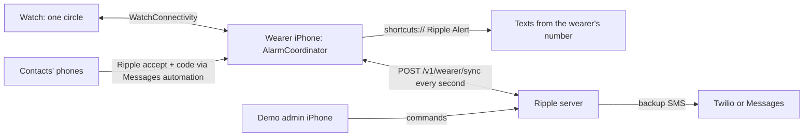

# Ripple — Implementation Plan

October 17, 2026 · Based on [PROJECT_KAZE_PRD.md](PROJECT_KAZE_PRD.md) (the Ripple PRD) · How to run it: [docs/RUNNING.md](../docs/RUNNING.md)

The MVP is all Swift: three SwiftUI apps for iPhone and Apple Watch (Series 9 target), a shared Swift package, and a Swift backend. This plan describes what is built, how the pieces divide the work, how each demo scenario is covered, and what is left to validate.

## 1. Stack

| Part | Choice | Why |
| --- | --- | --- |
| Wearer iPhone app | SwiftUI, iOS 17+ | Configuration, the alarm state machine, sending texts first |
| Apple Watch app | SwiftUI, watchOS 10+ (double tap on watchOS 11) | The one-circle interface; embedded in the wearer app |
| Demo admin app | SwiftUI, iOS 17+ | Triggers and inspects demo alarms through the backend |
| Shared code | `RippleKit` Swift package | Models, message templates, tier rules, `AlarmCoordinator`, API client. Used by all three apps and the server, so phone and backend apply the same rules. |
| Backend | Swift + Vapor, one process | Alarm mirror, backup sender, temporary-contact joins by text, admin relay. State is a single actor saved to a JSON file, so it survives restarts with nothing to install. |
| Phone texting | Apple Shortcuts ("Ripple Alert") | PRD's chosen demo path: real texts from the wearer's own messaging account |
| Backup texting | Twilio, or the Mac's Messages app, behind one adapter | PRD's declared backup sender |
| Watch link | WatchConnectivity | Display, configuration and circle actions |
| Checks | XCTest + GitHub Actions on macOS | Coordinator and backend rules tested with a fake clock; all apps compiled on every push |

## 2. Architecture

**The phone owns the alarm.** `AlarmCoordinator` (in RippleKit) holds monitoring on/off, the current alarm, its countdown, the duress flag, tiers, and every message with its status and sending path. The Watch only shows what the iPhone tells it and sends taps.

**The backend is a mirror and a declared backup.** Each sync carries the phone's alarm snapshot and works as its heartbeat. The backend sends a text only when it is overdue: due time + 30 s grace, or the phone has been quiet for 30 s and the due time has passed. Backup texts are marked "(Sent by Ripple backup.)". Message ids are `alarmId:recipientId:kind` on both sides, so the phone never repeats a backup text and the backup never repeats a phone text it heard about.

## 3. Alarm lifecycle

| Event | Phone (`AlarmCoordinator`) | Backend |
| --- | --- | --- |
| Alarm starts (check-in timer or admin) | Snapshot recipients (permanent contacts + active temporary contacts), generate a distinct reply code for each, build the texts, take one location fix if any contact shares location | Registers the alarm and reply codes on the next sync |
| Tap, double tap or voice in countdown | Close as dismissed; no texts | Sees it closed; no backup |
| 2-second hold (duress) in countdown | Mark duress, send the Tier 1 alert now; the Watch shows "Dismissed" | Alert due immediately; backup only if the phone goes quiet |
| Countdown ends | Text Tier 1 (Tier 2 if Tier 1 is empty) through the shortcut | Backup alert if overdue |
| Contact replies with their code | Shows "[Contact] is responding"; texts "Someone responding" to the others already texted | Learns who and when on sync; backs up the "responding" texts if the phone is quiet |
| Acknowledge window passes with no reply | Texts Tier 2 | Backup escalation if overdue |
| "I'm okay now" | Texts "okay now" to everyone already texted, cancels unsent texts, closes | Sees it closed; no further backup |
| Hold after texts went out | Duress: looks like a dismissal, escalation continues hidden | Keeps backing up as needed |
| Admin "Disable alarm" | Closes when the command arrives | Closes the mirror at once, so no backup fires even without the phone |
| Admin "Reset demo" | Clears the alarm on the next sync (new run id) | Deletes the wearer's alarms, messages, commands and temporary contacts |

A duress alarm is never shown on the Watch or the wearer's iPhone, and its texts use the normal alert wording. The demo admin app does show it, labelled as hidden from the wearer.

## 4. What each part contains

| Folder | Contents |
| --- | --- |
| `RippleKit/Sources/RippleKit` | `Config.swift` (contacts, tiers, settings), `Alarm.swift` (alarm, messages, `RecipientRules`, `MessageTemplates`), `AlarmCoordinator.swift`, `WatchMessages.swift`, `API.swift`, `RippleAPI.swift` |
| `RippleKit/Tests` | Coordinator scenarios: safe, timeout, privacy, tiers, acknowledgment, okay now, duress, backup hand-off, guards, reset, check-in timer |
| `server/Sources/RippleEngine` | `Engine+Wearer` (setup, sync, temporary contacts), `Engine+Backup` (backup sender rules), `Engine+Temporary` (invitations, join replies, one-hour expiry), `Engine+Admin` (pairing, commands, expire, reset) |
| `server/Sources/RippleServer` | Vapor routes, Twilio and Messages senders, worker loop, configuration |
| `server/Tests` | Backup scenarios driven by a real `AlarmCoordinator` as the phone |
| `apps/RippleWearer` | `WearerStore` (coordinator, sync loop, outage simulation), `ShortcutSender`, `PhoneConnectivity`, `LocationProvider`, screens for home, contacts, settings, shortcut setup |
| `apps/RippleWatch` | `CircleScreen` (circle, hold, double tap, voice), `WatchStore` (stored config, haptics), `WatchLink` |
| `apps/RippleAdmin` | Sign-in, pairing, dashboard with controls, per-recipient message status, command delivery, events |

## 5. Demo scenario coverage (PRD "MVP and demo checks")

| Scenario | Built by | Automated test |
| --- | --- | --- |
| Safe (tap, then double tap) | Watch circle + `dismiss` | `testDismissDuringCountdownSendsNothing`, `testDismissedAlarmNeverTriggersBackup` |
| No response (Tier 1 alert with location link) | `sendAlert`, `MessageTemplates.alert` | `testTimeoutTextsTierOneWithLocationOnlyWhereAllowed` |
| Unacknowledged alert (Tier 2) | `sendEscalation`, backend escalation backup | `testAckWindowEscalatesToTierTwo`, `testBackupEscalatesToTierTwoWhenNobodyAcknowledges` |
| False alarm ("okay now") | `sendOkayNow` | `testOkayNowTextsEveryoneAlreadyTexted`, `testOkayNowCancelsMessagesNotYetSent` |
| Duress (2-second hold) | `hold`, hidden display | `testDuressDuringCountdownLooksDismissedButAlerts`, `testDuressAfterAlertKeepsEscalatingOutOfSight`, `testDuressAlertIsBackedUpAndNeverRevealed` |
| Connectivity failure (backup SMS) | Admin "Cut phone connection" → phone outage; `Engine+Backup` | `testBackupTextsTheAlertWhenThePhoneGoesQuiet`, `testPhoneDoesNotRepeatWhatTheBackupSent` |
| Privacy (location per contact, expired contact gets nothing) | Per-contact `shareLocation`, temporary contact expiry | `testExpiredTemporaryContactGetsNothing` (both packages) |
| Reset without an old alarm returning | New run id, server-side deletion | `testResetClearsEverything`, `testResetMakesTheOldRunInert` |

## 6. Suggested split for the team

| Owner | Focus before the demo |
| --- | --- |
| Wearer iPhone + shortcut | Build and test the Ripple Alert shortcut on the real phone first (PRD: "prove the Shortcuts path early"). Check the x-callback return to Ripple, and what happens when the phone locks. |
| Watch | Double tap on the actual Series 9 with its accessibility settings; hold timing; haptic strength; voice dictation; keep the app open (Return to Clock: 1 hour). |
| Backend + backup | Twilio trial with verified teammate numbers (or the Messages relay); tunnel if contacts are off Wi-Fi; rehearse the connectivity-failure scenario. |
| Demo admin + pitch | Run all seven scenarios twice, record a backup video, present the honesty table. |

## 7. Still to validate (from the PRD)

- Sending from a locked phone or a backgrounded app. The MVP keeps Ripple in the foreground.
- That **Show When Run** off actually sends without the composer on the demo phone.
- Native double tap on the demo Watch, and gestures and voice with Parkinson's tremor.
- Accidental duress rate (2-second hold), false alarm rate, battery use, real response times.

## 8. Honesty table for the presentation

| Category | What to report |
| --- | --- |
| Demonstrated | Watch input, alarms, real texts to teammates, tiers, reply acknowledgements, duress, okay now texts, backup SMS, location permissions, contact expiry |
| Simulated | Alarm triggers, the wearer being unable to respond, phone failure ("Cut phone connection") |
| Assumed | Contacts read texts and act on them. The wearer keeps the phone charged and nearby. |
| Needs validation | Locked-phone sending, gestures and voice with tremor, accidental duress rate, false alarm rate, battery use, real response times |
