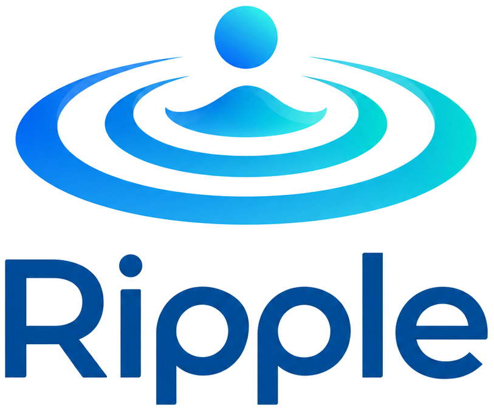

  

# Ripple

**Help when you can't ask for it.**

An Apple Watch safety companion that turns an unanswered check-in into a request for help from people you trust.

*Built for Hack the Valley 11 · Project KAZE*

  
   
  <a href="https://www.youtube.com/watch?v=gZr-bM_Hm6A" target="_blank"><Demo</strong></a>

## Quick Glance

- **Help when a check-in goes unanswered.** Ripple can alert trusted contacts when the wearer cannot respond.
- **Designed with Parkinson's in mind.** One large Watch circle, clear status messages, and haptic prompts keep interactions simple.
- **Touch, voice, or gestures.** Answer with a tap, chosen phrase, double tap, swipes, or one of ten AssistiveTouch presets.
- **Your people, reached by text.** Contacts need no app; reply acknowledgments and two contact tiers coordinate the response.
- **A discreet way to ask.** A two-second hold during an alarm looks like a dismissal while alerting continues.
- **Medication reminders with a safety check.** A missed dose acknowledgment can start a check-in before any contacts are alerted.
- **Support for the next hour.** Invite a consenting temporary contact who joins Tier 1 for a one-hour session.
- **Privacy on your terms.** Choose who receives a location snapshot and whether to include your help card.

## Independence, with someone in your corner

A safety plan needs to account for the moment a person cannot carry it out themselves. Reaching for a phone, finding a contact, explaining what happened, and pressing SOS all depend on being able [...]

Ripple starts with people living with Parkinson's, whose ability to move, speak, or use a phone can change during everyday life. Our goal is to help them stay independent while giving their truste[...]

The idea is simple: **set your preferences on your iPhone, answer a gentle prompt on your Watch, and let your circle of support know if you can't respond.** A missed response is enough to initiate[...]

That is our answer to KAZE's challenge: close the gap between **“I can't ask for help”** and **“someone knows to check on me.”**

## How a ripple becomes a response

1. **Choose your people and your timing.** Set check-in intervals, the time you need to answer, and how long to wait before reaching another group of contacts. Choose what each person can receive.
2. **Your Watch checks in.** One large circle, a visible countdown, and haptic prompts ask whether you're okay. Answer using your preferred supported input method.
3. **An unanswered check-in reaches Tier 1.** Your iPhone sends individual texts through your own messaging account. Contacts can call or check on you without installing anything.
4. **Someone takes responsibility, or the circle expands.** Each recipient gets a four-digit reply code. A valid reply tells Ripple who is responding; otherwise, the system reaches Tier 2 after th[...]
5. **You can close the loop.** Tap **I'm okay now** after an alert to update everyone already contacted and stop pending escalation. Monitoring can continue for the next check-in.

For example, a contact might receive:

> RIPPLE ALERT: Alex did not respond to their Watch check-in at 2:15 PM. Please call or check on them.
>
> Reply "Ripple accept 4821" if you are able to check in on Alex.

An optional note and a permitted location link give the recipient more context. When Maya replies with her code, the Watch can show **Maya is responding**, and other people already alerted receive[...]

## One circle. Several ways to stay connected.

The Watch is the everyday interface. Configuration stays on the iPhone, leaving one large target, a short status message, and a countdown when an answer is needed.

| Watch state | What the wearer sees |
| --- | --- |
| Monitoring off | Gray · **Start** |
| Monitoring active | Green · **Monitoring** |
| Awaiting a response | Yellow · **I'm okay**, with seconds remaining |
| Contacts alerted | Red · **I'm okay now** |
| Someone has acknowledged | Blue · **[Name] is responding** |

Status uses words and symbols alongside color. Haptics announce a check-in and repeat near the end of the countdown. Large text, VoiceOver labels and actions, and Reduce Motion support make the in[...]

### Answer in the way that works for you

**Touch, voice, and a whole range of gestures: more ways to say “I'm okay.”**

Tap the large circle. Say your chosen phrase. Double tap your fingers. Swipe down twice. Complete a selected pinch-and-clench sequence. Ripple gives the wearer several ways to answer a check-in an[...]

That flexibility is central to the experience. Movement, speech, and comfort can vary from one moment to the next, so the wearer can configure the response method that suits them. The aim is to ma[...]

| Input | What it offers |
| --- | --- |
| **Touch** | Tap the large circle to answer a check-in, or confirm you're okay after contacts have been alerted. |
| **Voice phrase** | Say a phrase you choose during an active alarm. The Watch passes microphone audio to the paired iPhone for speech recognition, requesting on-device recognition when supported.[...]
| **Native double tap** | Run the visible dismissal action on compatible Apple Watch hardware and watchOS. |
| **Swipe combinations** | Swipe up twice to request help; swipe down twice to confirm you're okay during an alarm. |
| **AssistiveTouch sequences** | Choose from ten presets built from pinch, clench, double pinch, and double clench, including combinations such as **pinch + clench**. Separate optional selections [...]

Touch remains available alongside the optional methods. AssistiveTouch supplies the hand recognition through Apple Shortcuts and Ripple's Watch App Intents; the active alarm state determines which[...]

The swipe matcher uses net movement and requires two deliberate swipes. Sequence timeouts and duplicate-input suppression help avoid carrying partial or repeated inputs into an unintended action. [...]

### A discreet signal when openly asking feels unsafe

During an alarm, **holding the circle for two seconds sends a duress signal**. The wearer sees the same **Dismissed** feedback as a normal dismissal, while alerting and escalation continue out of [...]

The wearer's Watch and iPhone hide the active duress alarm, and outgoing texts use ordinary alert wording. Duress stays tied to the deliberate touch hold; voice and gesture dismissal do not activa[...]

### Help can also be immediate

The two-up-swipe help action can notify Tier 1 immediately, even with monitoring off. During a countdown it sends the alert without waiting; after an unanswered alert it can advance to Tier 2. An [...]

On the iPhone, a confirmed **Emergency Help** action reaches both tiers and active temporary contacts immediately. An **I'm okay now** action is available afterward if the request was accidental.

## Your support network, on the phones they already use

Ripple's primary message path starts on the wearer's iPhone through **Ripple Alert**, an Apple Shortcut. Texts use the wearer's messaging account and follow the phone's SMS or iMessage configurati[...]

- **Two contact tiers:** choose who is texted first and who is contacted if nobody acknowledges. If Tier 1 has no eligible contacts, Tier 2 receives the initial alert.
- **Replies that coordinate help:** a distinct four-digit code identifies each recipient of the current alarm. The **Ripple Accept** shortcut and a Messages automation pass their reply back to th[...]
- **Shared awareness:** once a reply is accepted, other people already alerted are told who is checking, and further tier escalation stops.
- **A clear resolution:** the wearer's **I'm okay now** action updates previously alerted contacts and cancels messages that have not yet been handed off for sending.

Acknowledging means someone has agreed to check in. It does not establish that help has arrived. Closed-alarm replies, wrong codes, and replies for contacts not yet alerted are ignored; a known s[...]

### A trusted person for the next hour

Support can change with the situation. Invite a friend, companion, or someone nearby to become a **temporary contact** by text.

Their reply, **Ripple join** followed by a six-digit invitation code, records acceptance and starts a one-hour session on the backend. During that hour they join Tier 1. The wearer can remove the[...]

The invitation explains the role and whether alerts to that person will include location. The hour begins when the backend accepts the reply, so sending an invitation alone never activates a cont[...]

## Check-ins that fit daily life

### Medication reminders with a human fallback

Enter usual dose times on the iPhone. While monitoring is active, the Watch gives a gentle prompt and turns its circle into **Took my meds**. The iPhone offers the same acknowledgment and shows t[...]

If that tap doesn't arrive within the chosen grace period, Ripple starts an ordinary safety check-in. Contacts are reached only if that check-in also goes unanswered. The current feature uses ent[...]

### Follow-up on Apple Health alerts

Optional integrations can turn new fall records and high, low, or irregular heart rhythm events in Apple Health into a Ripple check-in. The wearer gets the usual opportunity to answer before cont[...]

Apple supplies the underlying health signals; Ripple adds a path to trusted people. This integration requires HealthKit capabilities, permission, and timely data synchronization. The demo app can[...]

## Privacy you can choose, contact by contact

The wearer controls their support network and what gets shared:

- **Location starts off.** Sharing is set separately for each contact. Ripple requests one location fix when an alarm starts if an eligible recipient has sharing enabled; it does not continuously[...]
- **See what you share.** Location previews and session details show the captured point, timestamp, and accuracy, with an option to open the same location in Maps.
- **Your words provide context.** An optional, wearer-written help card can explain something useful, such as where to find medication. It is off by default and included in the initial alert only[...]
- **Temporary support has an end.** Backend-enforced expiry prevents an old one-hour contact from receiving new alerts.
- **Your profile photo stays local.** The chosen image is stored on the iPhone and is not sent to the server or contacts.

The phone mirrors alarm snapshots and recipient details, including permitted location when available, to the Ripple backend. Production security, retention, and consent practices need further dev[...]

## An iPhone app that keeps the details manageable

Guided onboarding introduces the idea, builds a profile, adds a first trusted contact, and helps the wearer choose how to answer. The main app organizes daily use into **Home, Contacts, Sessions,[...]

Home combines a personal greeting with monitoring status, medication reminders, and immediate help. During an alarm, it brings the response and alerted contacts into focus. Contacts can be edited[...]

The iPhone app offers **English, French, Spanish, Simplified Chinese, and Traditional Chinese** language choices, plus an option to follow the iPhone's language. Untranslated strings fall back to[...]

Settings also make Watch synchronization visible: the phone and Watch report configuration versions, and the Watch retains its last received settings. An integrated shortcut guide and test-messag[...]

## Built to show how the difficult cases behave

A separate **Demo admin** iPhone app lets the team trigger alarms, simulate Apple Health events, cut phone communication, expire temporary contacts, adjust timers, disable alarms, and reset a dem[...]

The following table maps Ripple to KAZE's seven scenarios and identifies the current connectivity gap:

| Scenario | Ripple's prototype behavior |
| --- | --- |
| **Safe** | An answer during the countdown closes the check-in without texting contacts. |
| **No response** | The deadline initiates an alert to eligible first-tier contacts. |
| **Duress** | A two-second hold appears to dismiss the alarm while alerting continues. |
| **Connectivity failure** | Current limitation: Watch actions and primary alert sending rely on the paired iPhone. Automatic delivery after phone disconnection is not a verified demo capability.[...]
| **Unacknowledged alert** | Tier 2 is contacted after the acknowledgment window expires. |
| **False alarm** | **I'm okay now** updates people already alerted and stops pending escalation. |
| **Privacy** | Location follows per-contact settings; expired and removed temporary contacts receive no new alerts. |

Resetting creates a new demo run and clears old alarm work so a previous countdown cannot leak into the next scenario. The admin app exists for controlled demonstrations; it is not a deployed car[...]

## A credible prototype, with clear boundaries

Ripple's core is implemented across three native SwiftUI apps, a shared **RippleKit** package, and a **Swift + Vapor** backend. The phone and server share alarm models, recipient rules, and messa[...]

The repository includes clock-controlled XCTest coverage for countdowns, escalation, duress, replies, medication prompts, gesture matching, privacy rules, and temporary contacts. GitHub Actions i[...]

| Status | What it means here |
| --- | --- |
| **Implemented in the repo** | Watch and phone interfaces, check-in logic, messaging integrations, tiered escalation, coded replies, duress, temporary contacts, medication prompts, location cont[...]
| **Simulated for demonstrations** | A wearer being unable to respond, manually triggered alarms and health events, and phone failure through the admin control. No drug exposure, intentional inca[...]
| **Operational assumptions** | The wearer has a charged, paired iPhone and Watch; required permissions and shortcuts are available; contacts receive alerts and choose to act. The phone's primary[...]
| **Experimental backend code** | Server-side backup scheduling, sender adapters, and logic tests exist, but end-to-end fallback delivery is unverified. The default sender only logs messages. Bac[...]
| **Still needs validation** | Locked-phone and background behavior, Watch runtime limits, on-device AssistiveTouch and double-tap delivery, voice in noisy environments, use with Parkinson's moto[...]

Message status distinguishes **pending, submitted, failed, unknown, and cancelled**. Submission is not proof that a text was received or read. The prototype initiates a request for assistance; it does[...]

### Where Ripple can grow

The planning documents explore walk-session check-ins after prolonged step inactivity, optional step and medication context in alerts, movement-disorder context, and rhythmic comfort haptics. The[...]

Further work includes dependable background operation, a configured and validated alert-delivery fallback for phone disconnection, a supported physical-button input path, and validation with the people[...] 

## Explore the project

- [Product vision and requirements](Markdown%20files/PROJECT_KAZE_PRD.md)
- [Architecture and implementation plan](Markdown%20files/IMPLEMENTATION_PLAN.md)
- [Hand gesture design and device validation](docs/HAND_GESTURES.md)
- [Messaging shortcuts](shortcuts/README.md)
- [Running the prototype](docs/RUNNING.md)
- [MIT license](LICENSE)

**One small check-in. A wider circle of support.**
