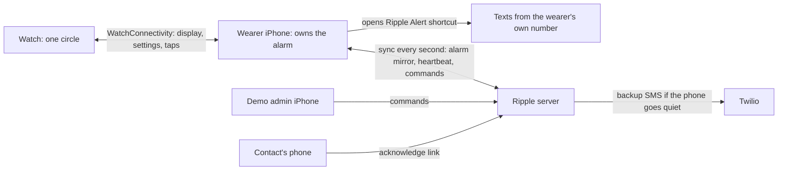

# Running the Ripple MVP

Everything is Swift. On a Mac you run the backend from Xcode or Terminal, then install three apps from one Xcode project: the wearer iPhone app (with its Apple Watch app) and the demo admin iPhone app.

## What you need

| Item | Notes |
| --- | --- |
| A Mac with Xcode 16 or newer | Xcode 26 recommended. It runs the backend and builds the apps. |
| Wearer iPhone | iOS 17 or later. iOS 18 or later if the Watch runs watchOS 11. |
| Apple Watch Series 9 or newer | watchOS 10 or later. Native double tap needs watchOS 11. |
| Second iPhone for the demo admin app | Any iPhone on iOS 17 or later. |
| Teammates' phones | They receive the texts. No app needed. |
| Apple ID | A free personal team is enough to install on your own devices. Builds expire after 7 days. |
| `cloudflared` on the Mac | `brew install cloudflared`. Lets contacts open the links in texts from any phone, including on cellular. No Cloudflare account needed. |
| Optional: Twilio account | Only for the backend's backup SMS. Without it, backup texts are printed in the server console. |

All phones and the Mac should be on the same Wi-Fi network. On venue Wi-Fi that blocks device-to-device traffic, use a phone hotspot or a tunnel (see [Reaching the server](#reaching-the-server)).

## 1. Start the backend

```bash
cd server
swift run RippleServer
```

Or open `server/Package.swift` in Xcode, pick the **RippleServer** scheme and **My Mac**, and press Run. The first build downloads Vapor and takes a few minutes.

The console prints the address to type into the apps, for example:

```
Enter this server address in the iPhone apps: http://192.168.1.20:8080
```

If `cloudflared` is installed, the server first starts a free Cloudflare quick tunnel and prints a public `https://….trycloudflare.com` address. Links in texts use it, so contacts' phones can open them from anywhere. The address changes each time the server starts; the wearer's iPhone picks up the new one by itself.

Allow incoming connections if macOS asks. Data is saved in `server/.data/ripple.json`; delete that file for a completely fresh start.

### Server settings

Set these as environment variables (in Xcode: **Product → Scheme → Edit Scheme → Run → Arguments → Environment Variables**).

| Variable | Default | Meaning |
| --- | --- | --- |
| `RIPPLE_PORT` | `8080` | Port to listen on |
| `RIPPLE_PUBLIC_BASE_URL` | The tunnel address, or `http://<Mac's Wi-Fi IP>:8080` without `cloudflared` | Start of the acknowledge and consent links in texts. Set it only to use your own public address; it turns the automatic tunnel off. |
| `RIPPLE_TUNNEL` | `auto` | `off` stops the server starting a quick tunnel even when `cloudflared` is installed. Links then only open on the same Wi-Fi. |
| `RIPPLE_CLOUDFLARED` | | Path to `cloudflared`, if it isn't in `/opt/homebrew/bin` or `/usr/local/bin` |
| `RIPPLE_ADMIN_SECRET` | `ripple-demo` | Password for the demo admin app |
| `RIPPLE_SMS` | `console` | Backup SMS route: `console`, `twilio`, or `messages` (the Mac's Messages app) |
| `TWILIO_ACCOUNT_SID`, `TWILIO_AUTH_TOKEN`, `TWILIO_FROM` | | Needed when `RIPPLE_SMS=twilio` |
| `RIPPLE_MESSAGES_SERVICE` | `iMessage` | For `RIPPLE_SMS=messages`: `iMessage` or `SMS` |
| `RIPPLE_DEMO_RECIPIENTS` | | Comma-separated E.164 numbers. If set, backup texts to anyone else are refused. |
| `RIPPLE_BACKUP_GRACE_SECONDS` | `30` | How long the phone may be quiet or late before the backup sends |

A Twilio trial account can only text numbers you've verified in the Twilio console, which suits a demo. Buy a Canadian number for Canadian recipients. Trial texts start with "Sent from your Twilio trial account".

## 2. Build the apps

1. Open `apps/Ripple.xcodeproj`.
2. Select the **Ripple** project (blue icon) → **Build Settings** → search for `RIPPLE_BUNDLE_PREFIX`. Change `com.htv11.ripple` to something unique to you, for example `com.yourname.ripple`. Bundle IDs can't be shared between Apple teams.
3. For each target (**RippleWearer**, **RippleWatch**, **RippleAdmin**): **Signing & Capabilities** → choose your **Team**.
4. Run **RippleWearer** on the wearer's iPhone. The Watch app is embedded and installs on the paired Watch automatically; you can also run the **RippleWatch** scheme directly on the Watch.
5. Run **RippleAdmin** on the second iPhone.

The first time, iOS asks you to trust the developer: **Settings → General → VPN & Device Management**. iOS also asks for local network access; allow it, or the apps can't reach the server.

## 3. Set up the wearer's iPhone

1. Open **Ripple**, enter the server address and the wearer's name.
2. **Contacts**: add teammates by name and phone number. Put at least one in **Tier 1** and one in **Tier 2**. Turn on **Share my location in alerts** for one of them only (for the privacy scenario).
3. **Settings**: keep the 15-second demo timers, turn on double tap, and optionally a voice phrase. Tap **Save**. **Watch settings** should show "Up to date". With the voice phrase on, allow speech recognition on the iPhone and the microphone on the Watch when asked.
4. Install the **Ripple Alert** and **Ripple Accept** shortcuts (below), send a test message from **Settings → Messaging shortcuts**, and add the reply automation.

### The messaging shortcuts

Ripple texts from the wearer's own phone through two shortcuts, both in the [`shortcuts`](../shortcuts) folder:

| Shortcut | Run by | What it does |
| --- | --- | --- |
| **Ripple Alert** | Ripple, through Apple's Shortcuts URL scheme | Sends each alert text to its own recipient, Show When Run off |
| **Ripple Accept** | A Messages automation | Passes a contact's "RIPPLE ACCEPT 4821" reply to Ripple |

iOS only imports signed shortcut files, and only a Mac can sign them. On a Mac, from the repository:

```bash
python3 scripts/build_ripple_shortcuts.py --sign
```

This writes `shortcuts/Ripple Alert.shortcut` and `shortcuts/Ripple Accept.shortcut`. CI also tries to sign them and, if that works on GitHub's Mac, attaches them to the run as the **ripple-shortcuts** artifact. Add `--validate-native` to check every action with the Mac's own Shortcuts parser. Neither shortcut depends on Ripple's bundle identifier, so one signed pair works for every teammate's build.

On the wearer's iPhone:

1. AirDrop both signed files to the iPhone and tap **Add Shortcut** for each. Keep the names.
2. In Ripple, open **Settings → Messaging shortcuts** and send a test message. Approve anything Shortcuts asks for.
3. In Shortcuts, open **Automation**, tap **+**, choose **Message**, set **Message Contains** to `Ripple accept`, choose **Run Immediately**, tap **Next**, and pick **Ripple Accept**.

Automations live on the phone and can't be shipped in a file, so step 3 is always manual.

Each recipient gets their own message, so nobody is in a group text. When Ripple Alert finishes, Shortcuts returns to Ripple (`ripple://shortcut?...`) and the message shows as **Submitted**. That only means the shortcut ran; confirm on the recipient's phone. Keep Ripple in the foreground during the demo, since opening Shortcuts from a locked phone or a backgrounded app is untested.

### Accepting by text reply

Every alert and second alert ends with "…or reply RIPPLE ACCEPT 4821", with a different 4-digit code for each person. When a contact replies:

1. The automation runs **Ripple Accept** with the message, which opens `ripple://accept?text=<the reply>`.
2. Ripple finds the code in the reply. Case, spacing and punctuation don't matter.
3. If the code belongs to someone who was texted for the open alert, it counts like tapping their link. The iPhone and Watch show "[Name] is responding", everyone else already texted gets "Ripple: [Name] is checking on [wearer]", and Tier 2 isn't texted.
4. The backend learns about it on the next sync, so its backup sender won't text Tier 2 either, and the link page shows who is checking.

A reply for a closed alert, someone not yet texted, or an unknown code is ignored, with a short note in Ripple. To test without the automation, paste a reply into **Settings → Messaging shortcuts → Try a reply** during an alert.

If the reply's sender is passed as a phone number and it differs from that contact's number, Ripple refuses it, so a forwarded code can't accept for someone else. During a duress alarm the reply still counts, but Ripple shows nothing on screen. The reply itself still appears in Messages, though.

<details>
<summary>Building Ripple Alert by hand instead</summary>

1. Tap **+** and name the shortcut **Ripple Alert** (the name is configurable in the app).
2. Open the shortcut's details and allow it to receive **Text** input.
3. **Get Dictionary from Input** (Shortcut Input).
4. **Get Dictionary Value**: value for `messages` in Dictionary.
5. **Repeat with Each** item in Dictionary Value.
6. Inside the repeat: **Get Dictionary Value** for `to` in Repeat Item, and another for `text` in Repeat Item.
7. Inside the repeat: **Send Message** with the `text` value as the message and the `to` value as the recipient. Expand it and turn off **Show When Run**.

</details>

## 4. Set up the demo admin

1. Open **Ripple Demo Admin**, enter the server address and the admin secret (`ripple-demo` unless you changed it).
2. Enter the 6-digit pairing code from the wearer's iPhone (**Settings → Demo admin pairing code**).

The admin can only control wearers it paired with.

## 5. Demo the seven scenarios

Start monitoring by tapping **Start** on the Watch circle. Keep the Watch app open and the wearer's iPhone unlocked with Ripple in front.

| Scenario | Steps | What judges see |
| --- | --- | --- |
| Safe | Admin: **Trigger alarm**. Wearer taps the circle. Trigger again; wearer double taps, or clenches with AssistiveTouch on. | Watch returns to green Monitoring. No texts. |
| No response | Trigger and let the countdown run out. | The iPhone opens Ripple Alert; Tier 1 phones receive the alert, one with a map link. |
| Unacknowledged alert | Tier 1 ignores the link for 15 seconds. | Tier 2 receives the escalation text. |
| False alarm | After texts go out, the wearer taps **I'm okay now**. | Everyone already texted receives "okay now". |
| Duress | Trigger; the wearer holds the circle for 2 seconds. | The Watch shows the normal "Dismissed" screen. Tier 1 still receives the alert. |
| Connectivity failure | Trigger, wait two seconds, then admin: **Cut phone connection**. | About 30 seconds later the backend sends the alert by SMS, marked "Sent by Ripple backup". |
| Privacy | Invite a temporary contact and have them agree. Admin: **Expire temporary contact now**, then trigger and let it run out. | Only the location-on contact gets a map link. The expired contact gets nothing. |

Then show **Reset demo** and that no old alarm comes back.

When someone taps an acknowledge link, the Watch and iPhone show "[Contact] is responding" and the other alerted contacts get "Ripple: [Contact] is checking on [Name]."

### Temporary contacts

On the wearer's iPhone: **Contacts → Invite for one hour**. The other person scans the QR code (or opens the shared link) and taps **I agree**. They join Tier 1 for one hour from that moment. **Remove now** ends it early. Expired or removed contacts never receive new alerts.

### Swipe combos

On the Watch circle, swipe up twice to ask for help, or swipe down twice during an alarm for "I'm okay". Turn them on or off in **Settings → Swipe combos** on the wearer's iPhone; they're on by default. Swipe on the circle, not from the screen edges, which open watchOS screens.

Help texts Tier 1 straight away, even when monitoring is off. During a countdown it stops waiting; after the alert it texts Tier 2 without waiting for the acknowledge window.

### Pinch and clench (AssistiveTouch)

In the wearer's iPhone app, **Settings → Hand gestures** offers ten preset sequences for answering an alarm. Enable **Hand gestures to dismiss**, choose the sequence, and **Save**. Wait for the Watch configuration version to match under **Watch sync**.

AssistiveTouch runs four one-action shortcuts—**Ripple Pinch**, **Ripple Clench**, **Ripple Double Pinch**, and **Ripple Double Clench**—which feed Ripple's background Watch App Intents. Ripple matches the saved sequence and uses the usual “I'm okay” action only after the complete match. Allow up to 5 seconds between inputs. With no alarm open, the inputs update Ripple's Watch receipt display for setup checks.

See [Hand gesture setup and device checks](HAND_GESTURES.md) for the exact presets, shortcut assignments, and test steps. These assignments require one-time setup in Apple's Watch settings and affect systemwide hand gestures. AssistiveTouch disables Apple's native double tap. Duress remains the touchscreen 2-second hold.

## Reaching the server

- **Links in texts** use the tunnel address when `cloudflared` is installed, so they open on any phone, on Wi-Fi or cellular. Without it they use the Mac's Wi-Fi address, which only phones on the same Wi-Fi can open; the server prints a warning.
- **The apps** can use the Mac's Wi-Fi address on the same network, or the tunnel address from anywhere. The tunnel address changes each time the server restarts, so the Wi-Fi address is less retyping.
- With the tunnel, the server is reachable from the internet. Set `RIPPLE_ADMIN_SECRET` to something only your team knows, instead of the default `ripple-demo`.
- Quick tunnels are Cloudflare's free testing service, with no uptime guarantee. If one fails to start, the server carries on with the Wi-Fi address and says so.
- If the iPhone can't connect, check that local network access is allowed (**Settings → Privacy & Security → Local Network**) and that the Mac's firewall lets RippleServer accept connections.

## How the pieces fit



- The wearer's iPhone runs the alarm state machine (`RippleKit/Sources/RippleKit/AlarmCoordinator.swift`) and always sends first.
- It registers each alarm with the server and syncs about every second. That is its heartbeat.
- If a text is 30 seconds overdue, or the phone has been quiet for 30 seconds past a deadline, the server sends it through Twilio and marks it as backup. When the phone comes back, it sees what the backup sent and doesn't repeat it.
- The server hosts the acknowledge page (`/a/<token>`) and the consent page (`/t/<token>`), and relays admin commands. It reports whether each command reached the iPhone.

## Tests

```bash
cd RippleKit && swift test
```

```bash
cd server && swift test
```

GitHub Actions runs both and builds all three apps for the simulator on every push to `main` (`.github/workflows/build.yml`).

## Known limits

| | |
| --- | --- |
| Shortcuts | Sending works with Ripple in the foreground on an unlocked iPhone. Locked or backgrounded sending is unverified. The Shortcuts app appears briefly on the wearer's screen while sending, including during duress. |
| Watch | The demo assumes the Watch app is open. Set **Settings → General → Return to Clock** to one hour on the Watch. While monitoring, the app keeps running with the screen off, using a mindfulness extended runtime session, so the iPhone can still reach it and haptics still play. A session lasts up to one hour; the next one starts when the app is in front again. Leaving the app ends it. |
| Voice | During an alarm the Watch microphone listens for the phrase by itself, with nothing to press. watchOS has no speech recognition, so the Watch streams the audio to the wearer's iPhone, which recognizes it (on the iPhone when supported). It needs both apps open, and the iPhone reachable. The app keeps running with the wrist down, but whether the microphone keeps recording then is untested. Anyone nearby who says the phrase also dismisses, so pick one nobody says by accident (the default is "I am currently fine"). If listening can't start, the Watch shows the tap-to-dictate microphone button instead. |
| Physical buttons | Not used; the side button and Digital Crown belong to the system. |
| AssistiveTouch | Apple recognises the four base inputs and runs assigned shortcuts. Ripple matches the chosen dismissal sequence. Background intent delivery, consecutive gesture timing, and Ripple staying visible require physical Watch testing; see [the setup guide](HAND_GESTURES.md). |
| Help location | Help texts go out immediately, so they include a map link only if an alarm was already running and had a location fix. |
| Backup | It covers a phone that stops syncing. If the phone sent a text but couldn't report it before going quiet, the backup may send a second copy, marked as backup. |
| Data | Demo data is deleted on reset. Tokens and phone numbers are stored in a JSON file on the Mac; this is a prototype, not production storage. |
